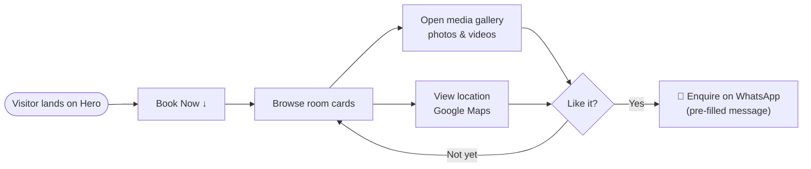

<div align="center">

# 🛕 Dharm Yatra Room Booking

**Book comfortable & affordable rooms in Ayodhya — a fast, animated, mobile-friendly booking site for pilgrims and travellers, with one-tap WhatsApp enquiries.**

[](https://dharm-yatra-room-booking.vercel.app)


[Features](#-features) · [User Flow](#-user-flow) · [Getting Started](#-getting-started) · [Customise Rooms](#%EF%B8%8F-adding-or-editing-rooms) · [Structure](#-project-structure)

</div>

---

## ✨ Features

| | Feature | Details |
|---|---|---|
| 🏨 | **Room & stay cards** | Each property shows a description, contact details and an expandable section |
| 🖼️ | **Media gallery popup** | Full-screen carousel mixing photos **and videos** of each room |
| 📍 | **Embedded Google Maps** | See exactly where every stay is located |
| 💬 | **WhatsApp booking** | Pre-filled WhatsApp message per room + a floating WhatsApp widget on every page |
| ✨ | **Smooth animations** | Hero and section reveals powered by Framer Motion |
| 📱 | **Responsive & dark-mode ready** | Tailwind CSS v4 with `dark:` variants throughout |
| 🧭 | **Multi-page** | Home (Hero · Services · About · Contact) and a dedicated About page |

## 🧭 User Flow



## 🚀 Getting Started

```bash
git clone https://github.com/Shariq2003/DharmYatraRoomBooking.git
cd DharmYatraRoomBooking
npm install
npm run dev          # http://localhost:5173
```

<details>
<summary><b>📜 Available scripts</b></summary>

| Command | What it does |
|---|---|
| `npm run dev` | Start the Vite dev server with HMR |
| `npm run build` | Production build into `dist/` |
| `npm run preview` | Serve the production build locally |
| `npm run lint` | Run ESLint |

</details>

## 🛠️ Adding or editing rooms

All room content lives in a single file — **[`src/utils/roomsData.js`](src/utils/roomsData.js)**. Each entry looks like:

<details>
<summary><b>Show room object shape</b></summary>

```js
{
  title: "Room name",
  bgImage: RoomBg,                                 // optional card background
  description: "Short pitch shown on the card",
  email: "bookings@example.com",
  phone: "+91 XXXXX XXXXX",
  link: "https://wa.me/91XXXXXXXXXX?text=...",     // WhatsApp deep link
  location: [
    { description: "2 km from …", url: "https://www.google.com/maps/embed?pb=..." },
  ],
  media: [
    { type: "images", data: [{ src: Img1 }, { src: Img2 }] },
    { type: "videos", data: [{ src: Video1 }] },
  ],
}
```

Drop the images/videos into `src/assets/<RoomName>/`, import them at the top of `roomsData.js`, and the new card appears automatically.

</details>

## 📁 Project Structure

<details>
<summary><b>Expand tree</b></summary>

```text
src/
├── components/
│   ├── sections/          # Hero, Services, AboutUs, ContactUs
│   ├── widgets/           # MediaCarouselPopup, WhatsAppWidget
│   ├── ServiceCard.jsx    # one room card
│   ├── ServicesSlider.jsx
│   ├── Header.jsx · Footer.jsx
├── pages/                 # Home, About
├── utils/roomsData.js     # ← all room content
└── assets/                # room photos & videos
```

</details>

---

<div align="center">

Built by **[Shariq](https://github.com/Shariq2003)** · [LinkedIn](https://www.linkedin.com/in/shariq-sd)

⭐ If you like this project, consider giving it a star!

</div>
